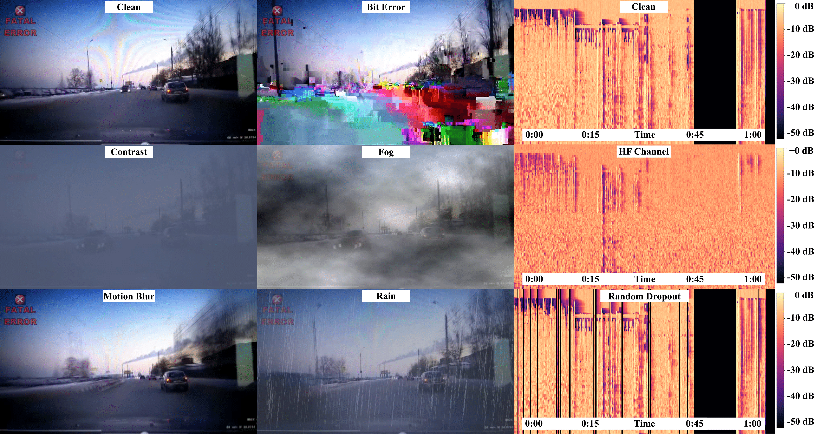

# RobustA: Robust Anomaly Detection in Multimodal Data

[Salem AlMarri](https://scholar.google.com/citations?user=Do6-P9EAAAAJ&hl=en&oi=ao/), [Muhammad Irzam Liaqat](https://scholar.google.com/citations?user=JX3rzZ8AAAAJ&hl=en&oi=ao), [Muhammad Zaigham Zaheer](https://scholar.google.com/citations?user=nFxWrXEAAAAJ&hl=en&oi=ao), [Shah Nawaz](https://scholar.google.com/citations?user=gHQwe2wAAAAJ&hl=en&oi=ao), [Karthik Nandakumar](https://scholar.google.com/citations?user=2qx0RnEAAAAJ&hl=en&oi=ao), [Markus Schedl](https://scholar.google.com/citations?user=TQR8qIEAAAAJ&hl=en&oi=ao)
<br>

> **Abstract:** In recent years, multimodal anomaly detection methods have demonstrated remarkable performance improvements over video-only models. However, real-world multimodal data is often corrupted due to unforeseen environmental distortions. In this paper, we present the first-of-its-kind work that comprehensively investigates the adverse effects of corrupted modalities on multimodal anomaly detection task. To streamline this work, we propose RobustA, a carefully curated evaluation dataset to systematically observe the impacts of audio and visual corruptions on the overall effectiveness of anomaly detection systems. Furthermore, we propose a multimodal anomaly detection method, which shows notable resilience against corrupted modalities. The proposed method learns a shared representation space for different modalities and employs a dynamic weighting scheme during inference based on the estimated level of corruption. Our work represents a significant step forward in enabling the real-world application of multimodal anomaly detection, addressing situations where the likely events of modality corruptions occur. The proposed evaluation dataset with corrupted modalities and respective extracted features will be made publicly available.

<div align="center">

[](https://arxiv.org/abs/2511.07276)

</div>


<div align="center">

<p><em>Examples of few visual and audio corruptions demonstrating the challenging scenarios presented in RobustA.</em></p>
</div>


## Table of Contents
- [Proposed Method](#proposed-method)
  - [Quick Start](#quick-start)
- [RobustA Benchmark](#robusta-benchmark)
  - [RobustA MP4 Files](#robusta-mp4-files)
  - [RobustA I3D Features](#robusta-i3d-features)
  - [RobustA VGGISH Features](#robusta-vggish-features)
- [Corruption Generation (Our Contribution)](#corruption-generation-our-contribution)
  - [Quick Start (Visual Corruption Generation)](#quick-start-visual-corruption-generation)
  - [Visual Corruptions](#visual-corruptions-video-corruption)
  - [Audio Corruptions](#audio-corruptions-video_features)
- [Feature Extraction](#feature-extraction)
  - [Quick Start (I3D Feature Extraction)](#quick-start-i3d-feature-extraction)
  - [Quick Start (VGGish Feature Extraction + Audio Corruptions)](#quick-start-vggish-feature-extraction--audio-corruptions)
  - [Paper-to-Code Naming Map](#paper-to-code-naming-map)
  - [I3D Feature Extraction](#i3d-feature-extraction)
  - [VGGish Feature Extraction](#vggish-feature-extraction-with-audio-corruption)
- [Citation](#citation)

---

## Proposed Method

The proposed RobustA method learns a shared representation space for RGB and Audio modalities using a single-branch architecture, and employs a dynamic weighting scheme during inference based on the estimated level of corruption. The full implementation is in the [`robusta-method`](robusta-method) directory, including:

- **Training**: on clean (uncorrupted) RGB (I3D) + Audio (VGGish) features
- **Evaluation**: under modality corruption with static or GMM-based dynamic weighting
- Pre-trained checkpoint and pre-fitted GMM models

### Quick Start

```bash
cd robusta-method
pip install -r requirements.txt

# Set up data paths (one-time)
bash setup_data.sh /path/to/your/data

# Evaluate: Audio babble corruption, 100%, static weighting
python infer.py --single-branch --modality MIX2 \
    --corrupt-modality AUDIO --corruption-percentage 1.0 \
    --test_corrupted_audio_list ./list/babble_3.list \
    --alpha 0.5 --beta 0.5

# Evaluate: same with GMM dynamic weighting
python infer_gmm.py --single-branch --modality MIX2 \
    --corrupt-modality AUDIO --corruption-percentage 1.0 \
    --test_corrupted_audio_list ./list/babble_3.list \
    --c 0.008 --x0 -500

# Full evaluation sweep (all corruptions, all percentages)
bash run_evaluate.sh
```

See [`robusta-method/README.md`](robusta-method/README.md) for detailed documentation on model architecture, file structure, GMM creation, and all parameters.

---
## RobustA Benchmark

This benchmark provides datasets for evaluating anomaly detection robustness across various corruption types in multimodal data. The original datasets and related resources are available at the [XD-Violence](https://roc-ng.github.io/XD-Violence/) repository. Below are the download links for each corruption type and model variant.

---
### RobustA MP4 Files

- **Bit Error:** [Download](https://www.dropbox.com/scl/fo/1fbktl0zltmh7d97tbqfc/AJpeJK-oTkcLFikHHeQ3Wrc?rlkey=835kovmcok5cwae5cdmbvi8va&st=nzf12lh7&dl=0)
- **Brightness:** [Download](https://www.dropbox.com/scl/fo/npgksz1yp5banfixlbm8u/AOCt6Ly0tunprJDkTF7YjlU?rlkey=6kw3osq1vm5h4ae4fd4xxywjk&st=rznwndwu&dl=0)
- **Contrast:** [Download](https://www.dropbox.com/scl/fo/582ze4eyvynndyiz6776n/AJ_S52cxluW6jEWIQy0_oxA?rlkey=qr91sp1r8ptp36fxv3vtlskfi&st=i5a19sb1&dl=0)
- **Fog:** [Download](https://www.dropbox.com/scl/fo/djmvu8cnhv9136dbjz3b7/AN3dAfPcGgmBwSTMaKkxl1Q?rlkey=sxj6haqykztkuvsj23nh31e08&st=s1ohh947&dl=0)
- **Motion Blur:** [Download](https://www.dropbox.com/scl/fo/p13jzhy6oua1bt7ro822n/ANT1iVrj1nvToohoP7sBdIE?rlkey=ijk3b4ayqmu119ibcbgwqpkkl&st=yeosywen&dl=0)
- **Rain:** [Download](https://www.dropbox.com/scl/fo/pzsju2adhxsgxxx4lml3k/AOIXlQrpFkjjfN9oxgp2kO4?rlkey=868znff3m1ztuad2cquuqjv4o&st=iddtfr0e&dl=0)
- **Saturate:** [Download](https://www.dropbox.com/scl/fo/pzsju2adhxsgxxx4lml3k/AOIXlQrpFkjjfN9oxgp2kO4?rlkey=868znff3m1ztuad2cquuqjv4o&st=iddtfr0e&dl=0)
- **Shot Noise:** [Download](https://www.dropbox.com/scl/fo/f2ir2w72qdb5qgeamvmax/AOiXJWjuuZ81uN75oE4zBvw?rlkey=gwjg4h2q5j8zf5luj1p30qz7h&st=ve31o2sz&dl=0)

---

### RobustA I3D Features

- **Bit Error:** [Download](https://www.dropbox.com/scl/fo/jy2l2r97nffd2ak36j8u1/AO0sbGpweJ0BXNL975BOz8s?rlkey=23sy9fnygmb9ez3t1mxsgnxwa&st=y2pywiqo&dl=0)
- **Brightness:** [Download](https://www.dropbox.com/scl/fo/692xjhhkzfhs207bfvoiw/AEnXedUEKv_RsGmeZcymzR4?rlkey=i25atw1xecfoygrc926ygq4zf&st=p7nuk0nm&dl=0)
- **Contrast:** [Download](https://www.dropbox.com/scl/fo/6f99or7wuy7ib41ujlh96/ABXhLugKYlEbzPrq2dqJEUo?rlkey=gyhet5t63vpbc67eiy4j2kz44&st=uiu5ea5b&dl=0)
- **Fog:** [Download](https://www.dropbox.com/scl/fo/x6ufc49d2hvm1qqezjine/AN5CVRi8LUjELMsbZOl5vTE?rlkey=un55ev45drtczmfi7k2ezcszw&st=j1dj35wf&dl=0)
- **Motion Blur:** [Download](https://www.dropbox.com/scl/fo/5s1bj85jl0d0byr4rvjch/AOUUx7jH05MVPaEsx3p9OP4?rlkey=qxxoray25ab8py6ta35e01dul&st=nbs2w0oj&dl=0)
- **Rain:** [Download](https://www.dropbox.com/scl/fo/xbzn24uvhfdwohmqpd1v7/ADyFTIJNW0_e-NEoJA_q9hE?rlkey=qdflp5h2prm542t5t2qfur98f&st=zs3e6d6d&dl=0)
- **Saturate:** [Download](https://www.dropbox.com/scl/fo/tbfwhaunbhhuaeokcaf5e/AEYH7CGxV2xDeHWygbkK-uk?rlkey=f31sy3ciy6rztztdfo8i0l41f&st=r1495njt&dl=0)
- **Shot Noise:** [Download](https://www.dropbox.com/scl/fo/tbfwhaunbhhuaeokcaf5e/AEYH7CGxV2xDeHWygbkK-uk?rlkey=f31sy3ciy6rztztdfo8i0l41f&st=r1495njt&dl=0)

---

### RobustA VGGISH Features

- **Babble:** [Download](https://www.dropbox.com/scl/fo/inqyoa68a01j2yenwbmrt/ALKzSJ7S9HHb81--tQAx9jk?rlkey=d32kk0wiiaegk8x6zuhnbetg4&st=n7ylwndw&dl=0)
- **Bitrate:** [Download](https://www.dropbox.com/scl/fo/cm3dlhu7lan8zk6jl46gl/AIrFPTPJBCZ8VYbJJT5HqkI?rlkey=cqeb8flypj1f5g8sttvtrj4h7&st=4iwlhahn&dl=0)
- **HFChannel:** [Download](https://www.dropbox.com/scl/fo/gaft2eo66dewy4rgk6d2c/AGlS6Oksjig5TtjC84QKHx8?rlkey=amjetu6s8t298z35abh5gjpun&st=da7xlrhm&dl=0)
- **Pink:** [Download](https://www.dropbox.com/scl/fo/5ijmoyv8m5zz2vboibysd/AAuFtWFJvkFKR8Zl1KGdKlQ?rlkey=xir2tz173il4eatduvg16bwym&st=mlpw7td5&dl=0)
- **Pitch Shift:** [Download](https://www.dropbox.com/scl/fo/b95ji6qilatwzlz07w9gu/AFRGdNMFSUTlP-tfSWdj2eQ?rlkey=cep2nedhxam0xyn94dhiux954&st=m84e8hfg&dl=0)
- **Random Dropout:** [Download](https://www.dropbox.com/scl/fo/rjefn17uilb049n5tq2vh/APZBNF-rH8hdG1CKrBPajb0?rlkey=0w5apn1rgevb71qriouljgogq&st=pcn7q5go&dl=0)
- **Reverb:** [Download](https://www.dropbox.com/scl/fo/ugsvoojjx47bkkv1ey7d8/ABZsHXR0QfnLmNAmOCv--dc?rlkey=vtzzpf0lkgj91jdx8fwk4xreu&st=q5di2lbw&dl=0)
- **White:** [Download](https://www.dropbox.com/scl/fo/lvhj8i8sxobt5arhql7eh/AMHziHedD9vqIzLjmIWFjm0?rlkey=7nk3a7t4c3mzi0slyetwduyrm&st=26uaymyx&dl=0)

---
## Corruption Generation (Our Contribution)

A key contribution of RobustA is the systematic creation of **visual and audio corruptions** applied to the XD-Violence dataset. We adapted and extended existing corruption toolkits to produce the RobustA benchmark.

### Quick Start (Visual Corruption Generation)

Generate corrupted MP4 files at severity 3 and 5:

```bash
cd video-corruption
pip install -r requirements.txt

# Edit paths in the script first:
# input_folder  = "../XD-Violence"
# output_folder = "../XD-Violence-Corrupted-3"
python corruptAllV2-3.py

# Edit output_folder to "../XD-Violence-Corrupted-5" (already set in V2-5)
python corruptAllV2-5.py
```

By default, scripts generate:
`shot_noise`, `rain`, `contrast`, `brightness`, `saturate`, `motion_blur`, `fog`, and `bit_error`.

### Visual Corruptions (`video-corruption/`)

We apply **8 visual corruption types** at multiple severity levels directly to XD-Violence MP4 videos:

| Corruption | Type | Implementation |
|---|---|---|
| Shot Noise | Per-frame (Python/NumPy) | Poisson noise |
| Rain | Per-frame (Python/OpenCV) | Synthetic rain overlay |
| Contrast | Per-frame (Python/NumPy) | Mean-centered scaling |
| Brightness | Per-frame (Python/OpenCV) | HSV channel adjustment |
| Saturate | Per-frame (Python/OpenCV) | Saturation scaling |
| Motion Blur | Clip-level (Python/NumPy) | Temporal frame averaging |
| Fog | Clip-level (Python/NumPy) | Plasma fractal blending |
| Bit Error | FFmpeg | Bitstream noise injection |

**What is ours vs. adapted:** The per-frame corruption functions (shot noise, rain, fog, etc.) are adapted from the severity definitions in [Yi et al., NeurIPS 2021](https://arxiv.org/abs/2110.06513), which targeted Kinetics/SSV2 datasets stored as HDF5 frames. **Our contribution** is `corruptAllV2-3.py` and `corruptAllV2-5.py`, which re-implement these corruptions for raw MP4 videos using OpenCV read/write, apply them at severity 3 and 5 to the entire XD-Violence test set, and produce the corrupted MP4 outputs from which I3D features are subsequently extracted.

The original benchmark framework (`benchmark_framework/`) is included for reference only.

See [`video-corruption/`](video-corruption) for the full code.

### Audio Corruptions (`video_features/`)

We apply **8 audio corruption types** at severity levels 3 and 5, producing corrupted VGGish features:

| Corruption | Method | Implementation |
|---|---|---|
| White Noise | Overlay (NoiseX-92) | Linear mix with volume matching |
| Pink Noise | Overlay (NoiseX-92) | Linear mix with volume matching |
| HF Channel | Overlay (NoiseX-92) | Linear mix with volume matching |
| Babble | Overlay (NoiseX-92) | Linear mix with volume matching |
| Bitrate | FFmpeg re-encode | Lossy compression at varying kbps |
| Pitch Shift | FFmpeg filter | Semitone shifting without tempo change |
| Reverb | FFmpeg aecho | Echo/reverb with severity-based params |
| Random Dropout | pydub | Random silent chunks inserted |

**What is ours vs. adapted:** The base feature extraction framework is from [v-iashin/video_features](https://github.com/v-iashin/video_features). **Our contribution** is the entire audio corruption pipeline in `extract_vggish.py` (inside the downloadable `models/` folder), which adds overlay mixing (using NoiseX-92 noise samples), bitrate compression, pitch shifting, reverb, and random dropout corruption methods to the VGGish extraction pipeline. The `run_ALL.sh` script orchestrates extraction of corrupted VGGish features for all 8 corruption types across the XD-Violence test set.

See [`video_features/`](video_features) for the full code and download links for required NoiseX-92 data and pretrained models.

---

## Feature Extraction

### Quick Start (I3D Feature Extraction)

Extract I3D features from clean/corrupted MP4 videos:

```bash
cd i3d-features-extractor

# Install dependencies in your environment
# (PyTorch + torchvision + ffmpeg-python + numpy)

# Download and convert pretrained weights
wget https://dl.fbaipublicfiles.com/video-nonlocal/i3d_baseline_32x2_IN_pretrain_400k.pkl -P pretrained/
python -m utils.convert_weights pretrained/i3d_baseline_32x2_IN_pretrain_400k.pkl pretrained/i3d_r50_kinetics.pth

# Run extraction
python main.py \
  --datasetpath ../XD-Violence-Corrupted-3 \
  --outputpath ../I3D-Corrupted-Features-Fixed-3
```

Repeat with `../XD-Violence-Corrupted-5` for severity 5.

### Quick Start (VGGish Feature Extraction + Audio Corruptions)

Use `video_features/main.py` for both clean and corrupted VGGish extraction.

```bash
cd video_features

# One-time setup:
# 1) Download NoiseX-92 into ./NoiseX-92
# 2) Download RobustA models folder into ./models

# Clean VGGish
python main.py \
  feature_type=vggish \
  device="cpu" \
  file_with_video_paths="XD_Violence_testing.txt" \
  output_path="./output_clean/vggish" \
  on_extraction="save_numpy"

# Corrupted VGGish (template for non-overlay corruptions)
python main.py \
  feature_type=vggish \
  device="cpu" \
  file_with_video_paths="XD_Violence_testing.txt" \
  output_path="./output_corrupted/<CORRUPTION_NAME>_<SEVERITY>" \
  on_extraction="save_numpy" \
  audio_corruption_type="<CORRUPTION_NAME>" \
  audio_severity=<SEVERITY>

# Batch corruption extraction using script
bash run_ALL.sh
```

For overlay corruptions (`white`, `pink`, `hfchannel`, `babble`), use `audio_corruption_type="overlay"` with `overlay_audio_type="<OVERLAY_NAME>"`. The module README provides full templates.

### Paper-to-Code Naming Map

To keep wording consistent with the paper while preserving repository file names:

#### Visual modality

- **Bit Error** -> `bit_error`
- **Brightness** -> `brightness`
- **Contrast** -> `contrast`
- **Fog** -> `fog`
- **Rain** -> `rain`
- **Motion Blur** -> `motion_blur`
- **Saturation** (paper wording) -> `saturate` (code/list naming)
- **Shot Noise** -> `shot_noise`

#### Audio modality

- **Overlay** (paper umbrella term) -> `white`, `pink`, `hfchannel`, `babble`
- **Bit Error / compression-style corruption** -> `bitrate`
- **Pitch Shift** -> `pitch_shift`
- **Random Dropout** -> `random_dropout`
- **Reverb** -> `reverb`

### I3D Feature Extraction

To extract I3D features from videos (clean or corrupted), use the [`i3d-features-extractor`](i3d-features-extractor) directory. Refer to its [`README.md`](i3d-features-extractor/README.md) for instructions.

### VGGish Feature Extraction (with Audio Corruption)

The [`video_features`](video_features) directory handles VGGish audio feature extraction with built-in corruption support. See its [`README.md`](video_features/README.md) for model setup and usage.

---
## Citation

If you find this project useful in your research, please consider citing:

```bibtex
@article{AlMarri2025RobustA,
  author = {AlMarri, S. and Liaqat, M. I. and Zaheer, M. Z. and Nawaz, S. and Nandakumar, K. and Schedl, M.},
  title = {RobustA: Robust Anomaly Detection in Multimodal Data},
  journal = {arXiv preprint arXiv:2511.07276},
  year = {2025}
}
```

### Supplementary Citations (Upstream Components)

The following works/tools are used or adapted in parts of this repository and should be cited separately when relevant to your usage:

- **XD-Violence dataset / baseline context**  
  [Wu et al., 2020 - Not only Look, but also Listen](https://arxiv.org/abs/2008.02521)
- **Video corruption benchmark components**  
  [Yi et al., 2021 - Benchmarking the Robustness of Spatial-Temporal Models Against Corruptions](https://arxiv.org/abs/2110.06513)
- **Audio/feature extraction framework base**  
  [v-iashin/video_features](https://github.com/v-iashin/video_features)
- **I3D feature extraction base components**  
  [pytorch-resnet3d](https://github.com/Tushar-N/pytorch-resnet3d), [pytorch-i3d-feature-extraction](https://github.com/Finspire13/pytorch-i3d-feature-extraction)
